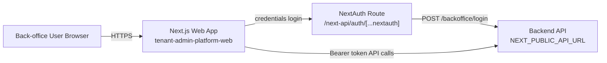
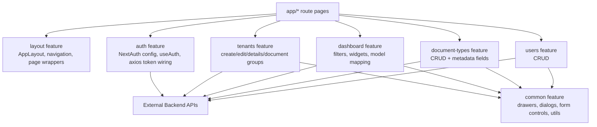
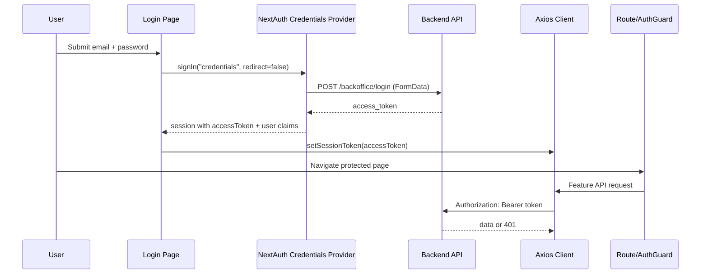
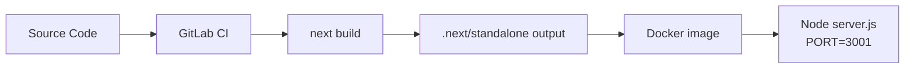

# Tenant Admin Platform Web - Architecture Design

## 1. Purpose and Scope

This document describes the implemented architecture of `tenant-admin-platform-web` (Next.js 14 + TypeScript), based on the current source code.

Primary responsibilities:

- Authenticate back-office users.
- Provide tenant administration workflows.
- Provide configuration workflows (document types and users).
- Provide AI usage dashboard analytics.

## 2. Technology Stack

- Framework: Next.js `14` (App Router)
- UI: React `18`, Material UI `7`, Carbon icons
- Auth/session: `next-auth` credentials provider (JWT session strategy)
- Data fetching/caching: `@tanstack/react-query`
- HTTP client: `axios` with centralized interceptors
- Forms: `react-hook-form`
- Charts: `recharts`
- Styling: MUI theme system + `sass`
- Build target: Next standalone output (`next.config.mjs -> output: "standalone"`)

## 3. High-Level System Context



Notes:

- The app does not manage domain persistence itself; all business data is served by external backend APIs.
- `next-auth` is used as the web session boundary; backend token is stored in JWT session and injected into API requests.

## 4. Runtime Composition

## 4.1 App Shell

- Root layout (`src/app/layout.tsx`) composes:
  - `InitColorSchemeScript`
  - `ClientProviders` (`SessionProvider` + `QueryProvider`)
  - `AuthGuard`
  - `AppLayout` (Topbar + SideNavbar + content region)
- Login route is rendered without side navigation/topbar chrome.

## 4.2 Route Structure

```text
/login
/dashboard
/tenants
/tenants/create
/tenants/[id]
/settings/document-types
/settings/users
/next-api/auth/[...nextauth]
```

## 4.3 Feature-Oriented Module Layout



## 5. Authentication and Session Flow

## 5.1 Design

- Credentials login is configured in `src/features/auth/api/authOptions.ts`.
- `authorize()` submits form data to backend endpoint `/backoffice/login`.
- Access token is decoded to get `sub` and `name`, then stored in JWT callback/session callback.
- `ClientProviders` observes session and sets in-memory Axios session token (`setSessionToken`).
- Axios request interceptor adds `Authorization: Bearer <token>`.
- Axios response interceptor signs out on `401` for non-login endpoints.
- `AuthGuard` redirects:
  - unauthenticated users to `/login`
  - authenticated users away from `/login` and `/` to `/dashboard`

## 5.2 Sequence



## 6. Data Access Architecture

## 6.1 API Client Layer

- Single shared Axios instance in `src/features/auth/api/axiosConfig.ts`.
- `baseURL` is `process.env.NEXT_PUBLIC_API_URL`.
- Feature API modules define endpoint-specific calls:
  - Tenants: `/admin/accounts`, `/admin/account/{id}/document-groups`, `/admin/users`, `/admin/config`
  - Dashboard: `/admin/ai-usage-dashboard`
  - Document types: `/admin/document-types`
  - Users: `/backoffice/users`

## 6.2 Query/Mutation Layer

- All read/write operations are wrapped in React Query hooks.
- Query keys are centralized per feature constants.
- Mutations invalidate list/detail keys to refresh stale UI state.

CRUD pattern:

1. UI submits form/event.
2. Hook mutation calls API module.
3. On success, invalidates related query keys.
4. Table/details view re-renders from refreshed cache.

## 7. Core Domain Workflows

## 7.1 Tenant Creation Workflow (Multi-Step)

`CreateTenant` orchestrates a multi-step wizard and submits the tenant at Preview step.

Step order:

1. General details
2. Brand and theming
3. AI services
4. SSO
5. Documents
6. Preview & create tenant (calls create tenant API)
7. Document groups
8. Add user (required to finish)
9. Success

```mermaid
flowchart TD
    A[Start Create Tenant] --> B[Fill Steps 1-5 in react-hook-form]
    B --> C[Preview Step]
    C --> D[Transform request body<br/>theming/sso/doc types/integrations/data sources]
    D --> E[POST /admin/accounts]
    E --> F[Store returned accountId in CreateTenantContext]
    F --> G[Manage Document Groups<br/>/admin/account/{id}/document-groups]
    G --> H[Create Initial User<br/>POST /admin/users]
    H --> I[Finish]
```

Key architectural choice:

- Tenant creation is split into staged operations with `accountId` propagated via `CreateTenantContext` after tenant creation succeeds.

## 7.2 Tenant Details/Edit Workflow

- Tenant details page loads `GET /admin/accounts/{id}`.
- Each section (general, branding, AI services, SSO, documents) opens drawer-based inline edit.
- `EditTenant` computes section-scoped request bodies and calls `PATCH /admin/accounts/{id}`.
- Document groups are managed separately via dedicated group APIs.

## 7.3 Dashboard Workflow

- Dashboard loads:
  - tenant list (`useGetTenants`)
  - admin config (`useGetAdminConfig`) for period options
  - usage data (`useGetAiUsage`) keyed by selected filters
- Filter changes are debounced (`300ms`) before querying.
- Response is mapped into model classes for chart-friendly structures.

## 8. Theming and White-Labeling

- MUI `ThemeProvider` is global in `AppLayout`.
- Color scheme mode persisted with key `mui-mode`.
- Topbar branding and page metadata vary by:
  - request host (`headers().get('host'|'x-forwarded-host')`)
  - tenant logo payload from API (base64 image content)
  - tenant `chat_strategy` to map title variants
- Dedicated TAQA login page is selected by host matching.

## 9. Deployment and Build Architecture



Implementation details:

- Dockerfile uses multi-stage build (`deps`, `builder`, `runner`).
- Runtime container runs as non-root `nextjs` user.
- Next config uses standalone output for smaller runtime surface.
- CI injects environment-specific `.env.*` files before build/package stages.

## 10. Configuration and Environment

Environment variables used by runtime:

- `NEXT_PUBLIC_API_URL`: backend API base URL for Axios.
- `AUTH_SECRET`: NextAuth signing secret.
- `NEXTAUTH_URL`: NextAuth URL base.

## 11. SSO Provider Support

The tenant creation wizard (Step 4: SSO) and tenant edit SSO section now support three identity providers:

| Provider | `type` value | Required config fields |
|----------|-------------|----------------------|
| Azure AD | `azure_ad` | `client_id`, `client_secret`, `tenant_id` |
| Google | `google` | `client_id`, `client_secret` |
| Keycloak | `keycloak` | `client_id`, `client_secret`, `tenant_id`, `keycloak_url` |

The SSO form should conditionally show `keycloak_url` when Keycloak type is selected. Backend `SsoConfig` model on Account stores the provider config.

## 12. Talent Automation Config (Backend Context)

The backend now supports `TalentAutomationConfig` on Account alongside `MatchWeightConfig`. This config controls M1-M4 talent automation modules (screening, enrichment, reroute, interview prep) with per-tenant toggles and thresholds.

Backoffice admins creating tenants should be aware this config exists but it is managed by tenant admins in the recruiter webapp Configurations page, not in this backoffice app.

## 13. Architectural Strengths and Risks

Strengths:

- Clear feature-based module boundaries.
- Centralized auth token handling and HTTP interception.
- Consistent query/mutation + invalidation strategy.
- Reusable shared UI primitives (drawers/dialogs/form elements).

Risks / technical debt:

- Some type definitions are loose (`Record<string, any>`, `any` in context/default values).
- Error handling mostly logs to console; user-facing error patterns are inconsistent.
- `AuthGuard` uses client-side redirect behavior only; no server-side auth gating.
- Root route (`/`) currently renders an empty `QueryClientProvider` component, which can be simplified or redirected explicitly.

## 14. Extension Guidance

Preferred extension pattern:

1. Add feature API module functions.
2. Add React Query hooks with feature query keys.
3. Build form/table/drawer UI from shared components.
4. Add route page thinly composing feature components.
5. Keep request body transformers in feature `utils` when backend contracts differ from form state.

## 15. Candidate Delivery Configuration (Recruitment Navigator)

`CandidateDeliverySection` is wired into the tenant edit page (`/tenants/[id]`) as a dedicated read/edit pair. It is recruitment-navigator-specific — other verticals may not expose this section.

### Components

| Component | Role |
|-----------|------|
| `CandidateDeliverySection` | Section entry: loads current config, renders view or opens edit drawer |
| `CandidateDeliveryView` | Read-only summary of all delivery settings |
| `CandidateDeliveryForm` | `react-hook-form`-based edit form; validated before submit |

### API surface

- Read: `GET /admin/accounts/{id}` — delivery config is a nested field on the account response.
- Write: `PATCH /admin/accounts/{id}` — section submits the `match_config` / `report_config` sub-objects only.

### Backend mapping

Form fields map to the API's `MatchWeightConfig` and a `ReportConfig` sub-object on Account:

| Form field | API field |
|-----------|-----------|
| Shortlist default size | `match_config.shortlist_size` |
| Candidate limit per job | `match_config.candidate_limit` |
| Delivery review threshold | `match_config.review_threshold` |
| Freshness bonus enabled | `match_config.freshness_bonus_enabled` |
| Freshness bonus points | `match_config.freshness_bonus_points` |
| Freshness window days | `match_config.freshness_window_days` |
| Matching cadence hours | `match_config.cadence_hours` |
| Report delivery enabled | `report_config.enabled` |
| Report count | `report_config.report_count` |
| Report period days | `report_config.period_days` |
| Notification recipients | `report_config.recipients` |

### Interfaces

- `MatchConfig` — `src/features/tenants/interfaces/match-config.interface.ts`
- `ReportConfig` — `src/features/tenants/interfaces/report-config.interface.ts`

### Extension pattern

Follow section 14 (extension guidance). Add new delivery fields by:
1. Updating the interface file.
2. Adding form controls inside `CandidateDeliveryForm`.
3. Adding display rows inside `CandidateDeliveryView`.
4. Adjusting the `PATCH` body transformer in the section component.

## 16. Provider Feature Flags (Recruitment Navigator)

Per-tenant on/off switches for external job connectors and sourcing flows, stored on the API `Account.provider_feature_flags` (`ProviderFeatureFlags` in `core42-pov-api/src/models/mongodb/models.py`). Edited on the tenant detail page (`ProviderFeatureFlagsSection` → `ProviderFeatureFlagsForm`), displayed via `ProviderFeatureFlagsView` with the recent audit trail (`useGetTenantProviderFeatureFlagAudit`).

### Keys

| Group | Keys |
|---|---|
| Sourcing / config | `linkedin_candidate_sourcing`, `candidate_provider_configs`, `job_position_provider_configs` |
| Job connectors (one per `ExternalJobSource`) | `jobs_bg_provider_flows`, `hlctech_provider_flows`, `a1_provider_flows`, `telus_digital_provider_flows`, `concentrix_provider_flows`, `avedo_provider_flows`, `dormakaba_provider_flows`, `gracher_provider_flows`, `solaredge_provider_flows`, `sutherland_provider_flows`, `postbank_provider_flows`, `commerzbank_provider_flows`, `ringcentral_provider_flows`, `cocacola_provider_flows` |

### Source of truth

- `src/features/tenants/interfaces/provider-feature-flags.interface.ts` — `ProviderFeatureFlags` type, `DEFAULT_PROVIDER_FEATURE_FLAGS`, labels, descriptions. Must mirror the API model field-for-field.
- `src/features/tenants/components/common/forms/ProviderFeatureFlagsForm.tsx` — `flagKeys` array controls toggle order in the form.
- `ProviderFeatureFlagsView` derives its chip list from `Object.keys(DEFAULT_PROVIDER_FEATURE_FLAGS)`; no edit needed there.

### Extension pattern

New connector in the API ⇒ in the same change set: add the key to the interface, defaults, labels, descriptions, and `flagKeys`. Typecheck (`tsc --noEmit`) fails if any record misses a key.

## 17. Decision Reasons and Decision Review (Recruitment Navigator, feature 254)

Purpose: recruiters in the webapp record why they Exclude, put On hold, Drop or Archive a candidate. The API stores each decision with its reasons, an optional note and a frozen match snapshot (score, rank, run number, explanation) in the tenant's `candidate_status_events`. The backoffice owns two things: whether the feature is available to a tenant (S4), and a read-only case-by-case review of the recorded decisions (S7). Commits: S4 `db017f5`, `6f72543`; S7 `6632de9`, `ab653f1`, `2c8d0e8`, `2dc5e84`; bug477 `7472ea3`. Both sections sit on the tenant detail page (`TenantDetails.tsx`, section titles `DECISION_REASONS`, `DECISION_REVIEW`). Data access uses TanStack Query hooks (`useDecisionReasonsAvailability`, `useDecisionReview`) over axios clients (`api/decisionReasonsApi.ts`, `api/decisionReviewApi.ts`). Query keys are scoped by tenant id (`tenantsConstants.decisionReasonsKeys`, `decisionReviewKeys`).

### 17.1 Two-layer model

| Layer | Who | Field | Where |
|---|---|---|---|
| Availability | Platform/backoffice admin | `decision_reason_config.available` | this app, "Decision Reasons" section |
| Configuration and on/off | Tenant admin | `enabled`, `required_for`, reason list | webapp Admin → Configurations → Advanced |

Reasons are asked for only when both are on. This app never writes the tenant's `enabled` or its list, except through the explicit per-tenant reset below. The tenant admin cannot change availability.

### 17.2 Decision Reasons panel (S4)

`components/common/view/DecisionReasonsPanel.tsx`, helpers `utils/decisionReasonsAvailability.ts`, types `interfaces/decision-reasons-availability.interface.ts`. API: `GET` / `PATCH /backoffice/accounts/{id}/decision-reasons`.

- Shows the "Decision reasons available" switch, plus read-only chips: tenant setting (Tenant: on/off), effective state (Active / Not active), the number of reasons in the list, and database schema (Ready / Not ready / Unknown).
- Toggling opens a confirm dialog. Enable text: "Enabling makes decision reasons active for this tenant immediately. Recruiters must pick a reason when they Exclude, put On hold, Drop, or Archive a candidate. The tenant admin can switch it off or edit the list." The disable text says recruiters will no longer be asked. The switch is optimistic and rolls back on failure.
- The API refuses to enable when the tenant DB lacks the decision columns: 409 `decision_schema_unhealthy` with `missing_columns` ("Database not ready: missing columns ... - deploy/migration needed"), or 409 `decision_schema_probe_failed` ("Could not check tenant database"). Load errors offer Retry. Other server errors append the API `detail.message`.
- "Reset to platform defaults" (confirm dialog) sends `reset_reasons: true` for this tenant only. It replaces the reason list and required statuses with the platform template. The API keeps custom reasons that recorded decisions already use, hidden. Success and failure show in a snackbar.

### 17.3 Decision Review section (S7)

`components/common/view/DecisionReviewPanel.tsx` (filters, table, export) and `DecisionReviewDrawer.tsx` (detail). Helpers in `utils/decisionReview.ts`, types in `interfaces/decision-review.interface.ts`. API: `GET /backoffice/accounts/{id}/decision-review`, `/{event_id}` and `/export`.

- Header text: "Read-only review of recruiter decisions for this tenant. Access is logged. The export contains candidate names and notes."
- **Filters** (draft, sent on "Apply filters"; "Reset" restores the defaults):
  - Statuses: multi-select of Excluded, On hold, Dropped, Approved, Sent to client. Default: Excluded, On hold, Dropped.
  - From / To dates (UTC days). Default: From = 30 days ago.
  - Reason codes (any of, comma separated).
  - Recruiter (email or id).
  - Job id.
  - Score min / max.
  - Sort: attention (default), newest, oldest.
  - "Needs attention only": also adds Excluded, Approved and Sent to client to the statuses.
  - "Include cascade events": default off.

  Client-side validation blocks Apply. The applied filters are summarised in words.
- **Table**: Candidate (with a "Candidate deleted" chip for purged candidates), Job, Decision (status chip + "Cascade"), "Score then → now" (snapshot score → current score; a marker and tooltip when the score is the current one because no snapshot exists; a "Drift" chip when the recruiter saw a different score or run), Reason, Attention ("High score excluded" / "Low score approved"; API default thresholds 80 / 40), Recruiter, Date (UTC). Paged with 25 / 50 / 100 rows (default 50). A row opens the drawer.
- **Drawer** ("Decision details"): status from → to, attention, reason(s), recruiter, decided at (UTC), decision note. Then "Snapshot vs now": frozen score, rank of total, run and scoring version at decision time next to the current values, the drift text, explanation at decision time and now, and a "shortened to fit the size limit" note for truncated snapshots. An info alert explains a missing snapshot: no match row at decision time, a snapshot error, redacted because the candidate was deleted, or recorded before decision reasons were enabled. Then candidate notes and job notes (chip: written for this job vs matched by time window) and the thumbs history (up/down chips with score and run).
- **Export**: "Export XLSX" / "Export CSV" use the APPLIED filters (disabled while there are unapplied edits or no rows), `max_rows` 20 000. The filename comes from `Content-Disposition`. A truncation notice is built from `X-Export-Rows` / `X-Export-Total` / `X-Export-Truncated`. The object URL is revoked after a delay.
- **Errors** are mapped by API code: `tenant_db_unavailable`, `decision_events_unavailable` (409, shown as a warning), `export_busy` (429), validation codes, and others with Retry.

### 17.4 Multiple reasons (bug477, 2026-10-30)

- A decision can carry several reasons. Rows and the drawer show all of them via `reasonsText`: `reason_labels` joined with ", ", else `reason_codes`, else the legacy single `reason_label` / `reason_code` / `event_reason`.
- Filter field "Reason codes (any of, comma separated)": `parseReasonCodes` trims and de-duplicates; the list request sends them comma-joined in `reason_code`, and the API returns rows matching ANY code. The applied-filter summary reads "reason a or b".
- Export files carry `reason_codes` / `reason_labels` columns (built by the API).

### 17.5 Tenant isolation and access

- Every call carries the tenant id from the route (`/tenants/[id]`) in the path. The API loads that account (404 when unknown) and filters every query by its `account_id`. The tenant is never sent in a body. The review section is keyed by tenant id, so switching tenants resets its state.
- The API serves these endpoints to backoffice users only, reads the tenant DB in a read-only session, and logs every access with the backoffice user id. Tenant admins have no review screen (out of scope).

### 17.6 Known limits

- The reset confirm text says custom reasons are lost. The API actually keeps custom reasons already used by recorded decisions, hidden (`kept_reasons`).
- No component-test infrastructure in this repo (`npm test` runs node tests on utils only). Dialog wiring was verified by browser QA.
- Open API bug469: an export slot can leak when a request is cancelled early (that API process then answers `export_busy` until restart), and live candidates not yet synced to PG show empty name/title.
- Score fallback: events without a snapshot show the current score (marked), so their attention can change after a rerun.
